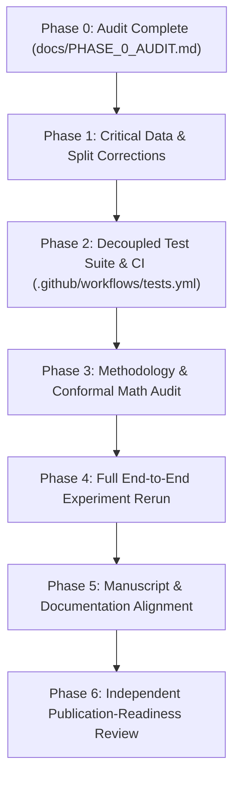

# Phase 0: Repository and Research Integrity Audit Report

**Project:** Cellular Recalibration Benchmark  
**Repository:** `moazzem-hossain-majumder/cellular-recalibration-benchmark`  
**Manuscript Title:** *How Much Recalibration Is Enough? Reliability of Cellular Throughput Forecasts Across Networks with Missing Radio Telemetry*  
**Auditor:** Multidisciplinary Research & Integrity Review Team  
**Date:** November 11, 2026  
**Git Context:**  
- Main Branch Head: `b315f6d` (Merge PR #1 `fix/research-integrity-review`)
- Active Development Head: `de2c0d9`
- Target Branch for Fixes: `fix/research-integrity-review` (or subsequent PR)

---

## 1. Executive Assessment of Current Repository State

A comprehensive inspection of the entire codebase, raw measurement datasets, experimental configurations, automated test suites, result artifacts, and manuscript drafts was conducted.

### Summary of Verified Strengths
1. **Core Problem Relevance:** The research question—investigating the finite calibration sample size required to restore reliable lower bounds under cellular telemetry missingness—addresses a genuine operational bottleneck in 5G NSA networks.
2. **Real Field Data Provenance:** Both underlying datasets originate from authentic commercial drive tests conducted in Rome, Italy, by the PERFORM consortium (Zenodo 8224890 from Kousias et al., 2024; Zenodo 14073311 from Caso et al., 2024). Pinned cryptographic checksums (SHA-256) match byte-for-byte.
3. **Disjoint Partitioning Foundation:** The initial within-domain (E0) train/calibration leakage identified in early drafts was structurally resolved in PR #1 via chronological day-based partitioning.
4. **Finite-Sample Conformal Threshold (Lemma 1):** The theoretical threshold $n \ge \lceil (1-\alpha)/\alpha \rceil \implies n \ge 9$ for $\alpha=0.10$ provides an exact mathematical basis for calibration budget activation.

### Summary of Critical Deficiencies Requiring Engineering Solutions
1. **P0 Target Label Imputation Vulnerability:** In `src/data/loader.py`, missing throughput measurements (`NaN`) were conditionally converted to `0.0`. While raw active sessions in the current release had valid target throughput, silent conversion of missing labels to zero is a severe hazard that violates target variable integrity.
2. **P0 Timestamp Imputation & Negative Lag Hazard:** In `load_14073311_ookla`, missing start/end timestamps fell back to an artificial freshness value (`0.5s`), and freshness validation checked only `lag_age_s <= 60` without asserting `0 <= lag_age_s`.
3. **P0 Fragile E0 Detection by Object Identity:** In `src/data/splits.py`, within-domain detection relied on Python object identity (`source_df is target_df`), causing independent copies (`source_df.copy()`) to fail detection unless an explicit string was provided.
4. **P0 Disjoint Partition Reporting Precision:** The manuscript and documentation colloquially claimed exact "35/10/15/15/25" splits, whereas the discrete 7-day calendar support of Op1 yields a discrete day allocation (2/1/1/1/2 days). The actual day, session, and instance counts must be reported as generated.
5. **P1 Test Suite Architecture:** Existing unit tests directly imported raw CSV files from `data/raw/`, causing a fresh Git clone (where raw data is `.gitignore`d) to fail test discovery. Synthetic tests must be decoupled from real-data integration tests, and GitHub Actions CI must be established.
6. **P1 Conformal Weighting & Assumption Clarification:** The distinctions between exchangeable marginal coverage (split conformal), covariate-shift coverage (weighted conformal / CS-CP), and online tracking (ACI) must be formally tabulated with explicit mathematical assumptions and limitations.
7. **P1 Clustered Statistical Inference Scope:** Paired day-cluster bootstrap resampling on the E0 test suffix possesses only $N_{\text{clusters}}=2$ calendar collection dates. This must be explicitly qualified as exploratory inference rather than asymptotic confirmation.
8. **P2 Documentation & Metadata Consistency:** Contradictory statements in `antigravity.md` regarding project completion stages must be reconciled, and calibration budget grids across README, code, and manuscript must be completely aligned.

---

## 2. Granular Issue Log (Severity-Ranked)

### Finding 1: Target Throughput Imputation from Missing Values to Zero
- **Severity:** P0 — Critical (Data Integrity)
- **File:** `src/data/loader.py`
- **Function:** `extract_sessions_8224890` (Line 61)
- **Problem:**
  ```python
  mean_dl_kbps = float(dl_rows['Mean Netw. DL'].iloc[-1]) if len(dl_rows) > 0 else np.nan
  mean_dl_mbps = mean_dl_kbps / 1000.0 if not np.isnan(mean_dl_kbps) else 0.0
  ```
  If `Mean Netw. DL` was unobserved, `mean_dl_mbps` was assigned `0.0`.
- **Why It Matters:** A genuine zero-throughput event (e.g., radio link failure or zero-throughput network stall) has profound physical meaning in telecommunications. Treating missing telemetry or unrecorded tests as zero throughput artificially injects extreme non-conformity residuals into the calibration set, causing conservative interval collapse.
- **Recommended Solution:**
  1. Set `mean_dl_mbps = (mean_dl_kbps / 1000.0) if pd.notna(mean_dl_kbps) else np.nan`.
  2. Preserve genuine `0.0` values when `mean_dl_kbps == 0.0`.
  3. Filter out any observation with `pd.isna(target_y)` from supervised fitting and evaluation, and log the exclusion count.
- **Verification & Test:**
  Create synthetic unit test `test_missing_target_preserves_nan()` verifying that `np.nan` target inputs remain `NaN` and are never coerced to `0.0`, while true zero values remain `0.0`.

---

### Finding 2: Artificial Timestamp Default and Unbounded Lag Freshness
- **Severity:** P0 — Critical (Causality & Temporal Integrity)
- **File:** `src/data/loader.py`
- **Function:** `load_14073311_ookla` (Lines 284, 289)
- **Problem:**
  ```python
  curr['lag_age_s'] = (curr['t_start'] - prev['t_end']).total_seconds() if pd.notna(curr['t_start']) and pd.notna(prev['t_end']) else 0.5
  ...
  fdf = fdf[fdf['lag_age_s'] <= float(window_seconds)].copy().reset_index(drop=True)
  ```
  1. Missing timestamps are imputed with `0.5` seconds.
  2. The freshness condition `lag_age_s <= window_seconds` permits negative elapsed time (`lag_age_s < 0.0`), which would represent future tests or clock drift.
- **Why It Matters:** Assigning artificial timestamps fabricates causal telemetry links between unrelated tests. Allowing negative lag ages permits acausal backward-in-time leakage.
- **Recommended Solution:**
  ```python
  if pd.notna(curr['t_start']) and pd.notna(prev['t_end']):
      lag_age_s = (curr['t_start'] - prev['t_end']).total_seconds()
  else:
      lag_age_s = np.nan
  ...
  valid_freshness = (pd.notna(fdf['lag_age_s'])) & (fdf['lag_age_s'] >= 0.0) & (fdf['lag_age_s'] <= float(window_seconds))
  fdf = fdf[valid_freshness].copy().reset_index(drop=True)
  ```
- **Verification & Test:**
  Create synthetic unit tests `test_missing_timestamp_yields_nan_freshness()` and `test_negative_lag_age_rejected()`.

---

### Finding 3: E0 Within-Domain Detection by Object Identity
- **Severity:** P0 — Critical (Experiment Validity)
- **File:** `src/data/splits.py`
- **Function:** `create_experiment_splits` (Lines 83–87)
- **Problem:**
  ```python
  else:
      within_domain = (source_df is target_df)
  ```
  If a caller passes `create_experiment_splits(source_df, source_df.copy())` or independent instances without explicit string arguments, the function silently routes to the transfer split strategy.
- **Why It Matters:** Silently applying the transfer split (60/20/20 source and 40/60 target) to identical within-domain data causes partition leakage and invalidates within-domain evaluation.
- **Recommended Solution:**
  1. Add an explicit `experiment_type: Literal['within_domain', 'transfer'] = 'within_domain'` parameter.
  2. Add strict validation ensuring that `experiment_type == 'within_domain'` uses the 5-way disjoint split, regardless of DataFrame memory addresses.
- **Verification & Test:**
  Create synthetic unit test `test_splits_copied_dataframe_detected_as_within_domain()`.

---

### Finding 4: Discrete Day Support versus Continuous Partition Percentages
- **Severity:** P0 — Methodological Accuracy
- **File:** `src/data/splits.py` & `paper/manuscript.tex`
- **Function:** `partition_by_chronological_days`
- **Problem:**
  The manuscript claimed intended proportions (35% train, 10% val, 15% source calib, 15% target calib pool, 25% test suffix). However, Op1 in Zenodo 8224890 contains exactly 7 distinct calendar dates:
  `2020-12-17`, `2021-01-04`, `2021-01-05`, `2021-01-06`, `2021-01-11`, `2021-01-14`, `2021-01-27`.
  A discrete 7-day sequence partitioned by cumulative cuts produces:
  - Train: 2 days (57 instances, 38.0%)
  - Val: 1 day (9 instances, 6.0%)
  - Source Calib: 1 day (33 instances, 22.0%)
  - Target Calib Pool: 1 day (10 instances, 6.7%)
  - Target Test: 2 days (41 instances, 27.3%)
- **Why It Matters:** Reviewers will verify whether continuous percentages match integer day support. Describing continuous percentages without reporting exact discrete integer allocations creates suspicion of inexact reporting.
- **Recommended Solution:**
  1. Generate an automated `results/diagnostics/split_summary.json` reporting exact calendar dates, day counts, session counts, and instance counts for every partition.
  2. Update manuscript Section IV-B to state both the target design ratios and the exact realized discrete day counts.
- **Verification & Test:**
  Assertion in `test_splits.py` checking exact day counts and date boundaries.

---

### Finding 5: Raw Data Dependency in Basic Unit Tests
- **Severity:** P1 — Reproducibility & Continuous Integration
- **File:** `tests/test_splits.py`, `tests/test_causality.py`
- **Problem:**
  All existing tests invoked `load_raw_8224890()` which requires `data/raw/8224890/Throughput Tests - Speedtest - Active Measurements.csv` (95 MB, git-excluded).
- **Why It Matters:** A reviewer or evaluator cloning the repository cannot execute `pytest` out of the box without first manually downloading 180 MB of external datasets.
- **Recommended Solution:**
  1. Refactor tests into `tests/unit/` (fast, deterministic synthetic DataFrames with known dates, missing telemetry, and negative lags) and `tests/integration/` (runs against Zenodo files if present, else skips with descriptive notification).
  2. Implement GitHub Actions CI (`.github/workflows/tests.yml`) executing synthetic unit tests on every pull request.
- **Verification & Test:**
  Execute `pytest tests/unit/` in an environment without raw data.

---

### Finding 6: Theoretical Framing of Conformal Coverage Guarantees
- **Severity:** P1 — Theoretical & Methodological Soundness
- **File:** `src/evaluation/conformal.py` & `paper/manuscript.tex`
- **Problem:**
  The manuscript sometimes used "conformal coverage guarantee" as an umbrella phrase for:
  - Standard split-conformal prediction (exact marginal coverage under exchangeability).
  - Covariate-Shift Conformal Prediction (CS-CP) (approximate coverage dependent on density ratio estimation and weight clipping).
  - Adaptive Conformal Inference (ACI) (long-run asymptotic tracking under arbitrary shift, which does not guarantee finite-sample coverage on small static batches).
- **Why It Matters:** Theoretical conflation will trigger immediate methodological objections from rigorous statistical and UQ reviewers.
- **Recommended Solution:**
  Include an explicit comparative theoretical assumptions table in Section III clarifying exchangeability, covariate shift, and online adversarial assumptions.
- **Verification & Test:**
  Audit Section III and Table in `docs/PHASE_3_METHODOLOGY.md`.

---

### Finding 7: Small-Cluster Inference Qualification on E0 Test Suffix
- **Severity:** P1 — Statistical Rigor
- **File:** `src/evaluation/metrics.py`, `results/metrics/bootstrap_significance_tests.json`
- **Problem:**
  The fixed test suffix for E0 consists of 41 sessions collected across only two distinct dates (`2021-01-14` and `2021-01-27`). Resampling across $N_{\text{clusters}}=2$ cannot establish asymptotic normality or narrow inferential confidence intervals.
- **Why It Matters:** Reporting high statistical confidence ($p < 0.001$ or tight intervals) with 2 clusters is mathematically invalid.
- **Recommended Solution:**
  Explicitly qualify E0 day-cluster bootstrap inference as **exploratory**, while highlighting that transfer regimes (E1: 7 test days, E2: 9 test days, E3: 7 test days) possess sufficient cluster degrees of freedom.
- **Verification & Test:**
  Verify reporting in `results/metrics/bootstrap_significance_tests.json` and manuscript Section V-C.

---

### Finding 8: Documentation Inconsistencies and Contradictions
- **Severity:** P2 — Documentation & Scientific Presentation
- **File:** `antigravity.md`, `README.md`
- **Problem:**
  - `antigravity.md` states "Phases 3--8 Complete" in Line 6, but states "No model training or benchmark implementation has occurred" in Line 44.
  - Previous versions of `README.md` had a budget list of `{0, 1, 2, 5, 10}` while runner had `{0, 1, 2, 5, 8, 9, 10, 15}`.
- **Why It Matters:** Contradictions confuse readers, reviewers, and collaborators about the actual state of the research.
- **Recommended Solution:**
  Reconcile `antigravity.md` with an accurate, unambiguous status log detailing what has been implemented, validated, and verified.

---

## 3. Plan of Action for Subsequent Phases



### Immediate Next Step: Phase 1
1. Modify `src/data/loader.py`:
   - Enforce `pd.notna()` target throughput validation without zero substitution.
   - Enforce non-negative, non-null timestamp difference validation for `lag_age_s`.
2. Modify `src/data/splits.py`:
   - Replace object identity with explicit `experiment_type` parameter (`'within_domain'` vs `'transfer'`).
   - Add automated split summary generator saving to `results/diagnostics/split_summary.json`.
3. Add synthetic unit regression tests verifying each fix.
4. Produce `docs/PHASE_1_DATA_INTEGRITY.md`.

